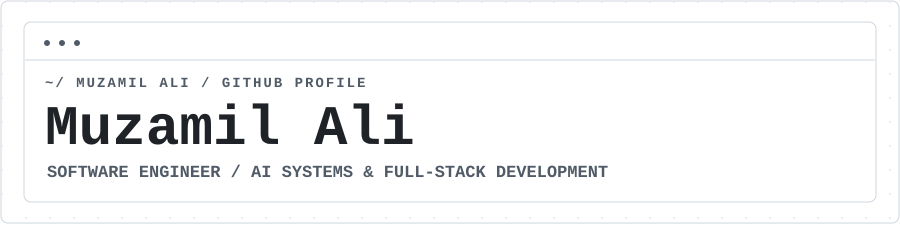
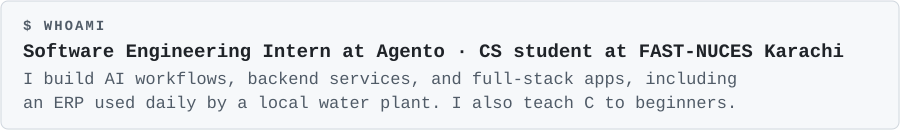
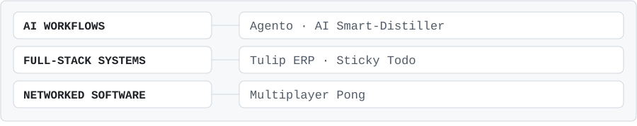
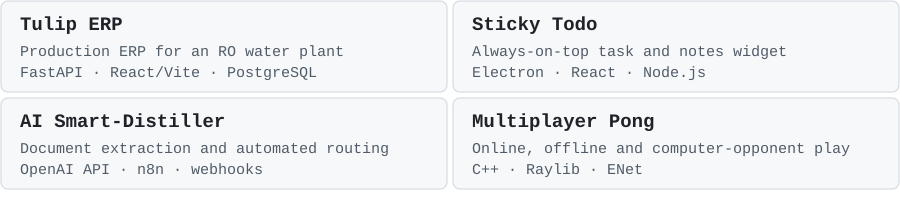
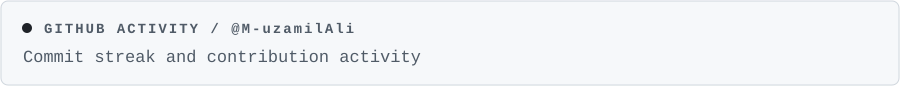
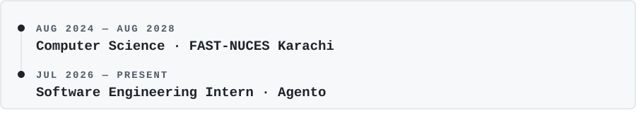
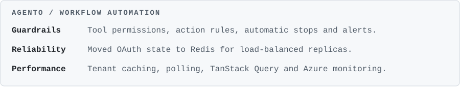
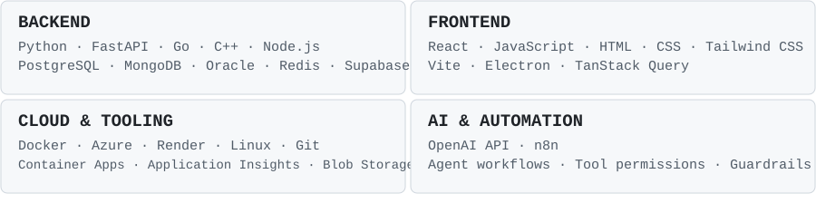

<picture><source media="(prefers-color-scheme: dark)" srcset="profile-assets/dark/header.svg"/></picture>

<a href="https://www.muzamilali.online/"><picture><source media="(prefers-color-scheme: dark)" srcset="https://img.shields.io/badge/PORTFOLIO-0d1117?style=flat-square&amp;logoColor=ffffff"/></picture></a>
<a href="https://www.muzamilali.online/cv.pdf"><picture><source media="(prefers-color-scheme: dark)" srcset="https://img.shields.io/badge/RESUME-0d1117?style=flat-square&amp;logo=adobeacrobatreader&amp;logoColor=ffffff"/></picture></a>
<a href="https://www.linkedin.com/in/muzamil-ali-b771aa356"><picture><source media="(prefers-color-scheme: dark)" srcset="https://img.shields.io/badge/LINKEDIN-0d1117?style=flat-square&amp;logo=linkedin&amp;logoColor=ffffff"/></picture></a>
<a href="https://dev.to/m-uzamiali"><picture><source media="(prefers-color-scheme: dark)" srcset="https://img.shields.io/badge/DEV.TO-0d1117?style=flat-square&amp;logo=devdotto&amp;logoColor=ffffff"/></picture></a>
<a href="mailto:me@muzamilali.online"><picture><source media="(prefers-color-scheme: dark)" srcset="https://img.shields.io/badge/EMAIL-0d1117?style=flat-square&amp;logoColor=ffffff"/></picture></a>

<picture><source media="(prefers-color-scheme: dark)" srcset="profile-assets/dark/s01.svg"/></picture>

<picture><source media="(prefers-color-scheme: dark)" srcset="profile-assets/dark/whoami.svg"/></picture>

<picture><source media="(prefers-color-scheme: dark)" srcset="profile-assets/dark/s02.svg"/></picture>

<picture><source media="(prefers-color-scheme: dark)" srcset="profile-assets/dark/ecosystem.svg"/></picture>

<picture><source media="(prefers-color-scheme: dark)" srcset="profile-assets/dark/s03.svg"/></picture>

<picture><source media="(prefers-color-scheme: dark)" srcset="profile-assets/dark/projects.svg"/></picture>

<a href="https://github.com/M-uzamilAli/WATER_PLANT_FULL_STACK_APP">Tulip ERP</a> ·
<a href="https://github.com/M-uzamilAli/Sticky-Todo-Desktop-App">Sticky Todo</a> ·
<a href="https://github.com/M-uzamilAli/AI-Smart-Distiller">AI Smart-Distiller</a> ·
<a href="https://github.com/M-uzamilAli/Pong-OOP">Multiplayer Pong</a>

Project descriptions, case study, and downloads

### [Tulip ERP](https://github.com/M-uzamilAli/WATER_PLANT_FULL_STACK_APP) — Production System
Built solo for a reverse osmosis (RO) water plant to manage customers, pricing, deliveries, and billing. Uses **FastAPI, React/Vite, and PostgreSQL**, with stored procedures and atomic transactions to prevent partially saved dispatch batches. Reduced daily dispatch preparation from **approximately 20 minutes to under 5 minutes**. Used daily by the business.

[Read the case study](https://www.muzamilali.online/tulip-erp.html)

### [Sticky Todo](https://github.com/M-uzamilAli/Sticky-Todo-Desktop-App) — Desktop App
An **always-on-top desktop widget** that brings personal notes and tasks from **ClickUp, GitHub, and Google Classroom** into one window. Built with **Electron, React, and Node.js**, with OAuth 2.0 integrations and login tokens encrypted locally. Shipped as an installable desktop app.

[Download the latest release](https://github.com/M-uzamilAli/Sticky-Todo-Desktop-App/releases/latest)

### [AI Smart-Distiller](https://github.com/M-uzamilAli/AI-Smart-Distiller)
Team project; **I built the backend and API integrations**. Extracts structured summaries, tasks, and deadlines from documents using the **OpenAI API**, then routes results to Google Sheets, Discord, or email through **n8n** and webhooks.

### [Multiplayer Pong](https://github.com/M-uzamilAli/Pong-OOP)
Collaborative C++ project using **Raylib and ENet**, with online, offline, and computer-opponent modes. Integrated network synchronization for two-player gameplay and built an object-oriented engine with swappable themes and skins. Renders at 60 FPS.

<picture><source media="(prefers-color-scheme: dark)" srcset="profile-assets/dark/s04.svg"/></picture>

<picture><source media="(prefers-color-scheme: dark)" srcset="profile-assets/dark/telemetry.svg"/></picture>

<picture><source media="(prefers-color-scheme: dark)" srcset="https://streak-stats.demolab.com/?user=M-uzamilAli&amp;theme=github-dark-blue&amp;hide_border=true"/></picture>

<picture><source media="(prefers-color-scheme: dark)" srcset="https://github-readme-activity-graph.vercel.app/graph?username=M-uzamilAli&amp;bg_color=00000000&amp;color=f0f6fc&amp;line=f0f6fc&amp;point=f0f6fc&amp;area_color=f0f6fc&amp;area=true&amp;hide_border=true&amp;radius=0&amp;custom_title=CONTRIBUTION%20TELEMETRY"/></picture>

<picture><source media="(prefers-color-scheme: dark)" srcset="profile-assets/dark/s05.svg"/></picture>

<picture><source media="(prefers-color-scheme: dark)" srcset="profile-assets/dark/timeline.svg"/></picture>

<picture><source media="(prefers-color-scheme: dark)" srcset="profile-assets/dark/experience.svg"/></picture>

<picture><source media="(prefers-color-scheme: dark)" srcset="profile-assets/dark/s06.svg"/></picture>

<picture><source media="(prefers-color-scheme: dark)" srcset="profile-assets/dark/stack.svg"/></picture>

<picture><source media="(prefers-color-scheme: dark)" srcset="profile-assets/dark/footer.svg"/></picture>

<!-- One responsive picture per visual. Layout inspired by Sharann-del. -->
