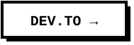
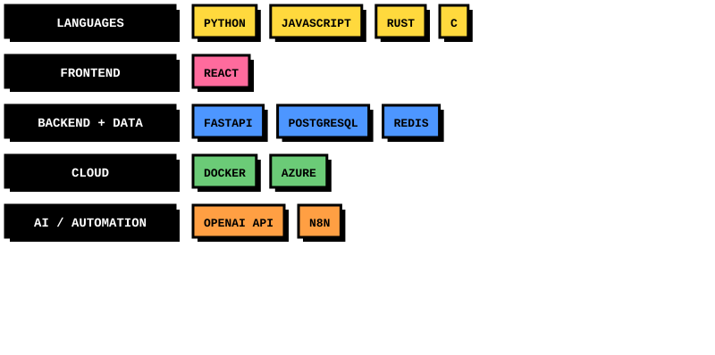

  

 

 

I’m a **Software Engineering Intern at Agento** and a third-year Computer Science student at **FAST-NUCES Karachi**. I build AI workflows, backend services, and full-stack applications, including an ERP used daily by a local water plant.

At Agento, I contribute to a workflow automation platform, working on:

- 🟨 **AGENT GUARDRAILS:** tool permissions, rules that constrain agent actions, and automatic stops and alerts for rule violations.
- 🟪 **BACKEND RELIABILITY:** fixed OAuth state handling across load-balanced replicas by moving state to Redis.
- 🟦 **PERFORMANCE AND MONITORING:** multi-tenant caching and polling, TanStack Query caching, and service monitoring with Azure Application Insights.

I also teach C programming to beginners, focusing on problem-solving, pointers, and memory management.

 
  

 

 

 

 

> Built solo for a reverse osmosis (RO) water plant to manage customers, pricing, deliveries, and billing. Uses **FastAPI, React/Vite, and PostgreSQL**, with stored procedures and atomic transactions to prevent partially saved dispatch batches. Reduced daily dispatch preparation from **approximately 20 minutes to under 5 minutes**. Used daily by the business.
>
> **→ [READ THE CASE STUDY](https://www.muzamilali.online/tulip-erp.html)**

 

> Capture screenshots from anywhere, let them **queue up in memory**, and send them all into an AI chat with one shortcut, instead of snip, switch tab, paste, switch back for every one. Built in **Rust** on the Windows APIs: it finds the focused text box through the **UI Automation** accessibility layer and confirms each paste through a delayed-rendering **clipboard promise**, so it works in ChatGPT, Claude, and WhatsApp with no app-specific code. Cut a 9-screenshot task from **17 tab switches to 1**; about 15 MB of RAM when idle, under 1 MB on disk. Open source (MIT).
>
> **→ [DOWNLOAD THE LATEST RELEASE](https://github.com/M-uzamilAli/SnapRelay/releases/latest)**

 

> An **always-on-top desktop widget** that brings personal notes and tasks from **ClickUp, GitHub, and Google Classroom** into one window. Built with **Electron, React, and Node.js**, with OAuth 2.0 integrations and login tokens encrypted locally. Shipped as an installable desktop app.
>
> **→ [DOWNLOAD THE LATEST RELEASE](https://github.com/M-uzamilAli/Sticky-Todo-Desktop-App/releases/latest)**

 

> Team project; **I built the backend and API integrations**. Extracts structured summaries, tasks, and deadlines from documents using the **OpenAI API**, then routes results to Google Sheets, Discord, or email through **n8n** and webhooks.

 

> A browser game where **your phone becomes the controller**: the PC shows the course, and tilting the phone sets the drone's height. The phone pairs over local Wi-Fi by **QR code** with a local **HTTPS** server (Node.js) and streams its **motion sensors**; the game predicts the tilt about **40 ms ahead** to hide input delay. The course speeds up and unlocks new obstacle patterns as the score rises.

 

**ME@MUZAMILALI.ONLINE**

