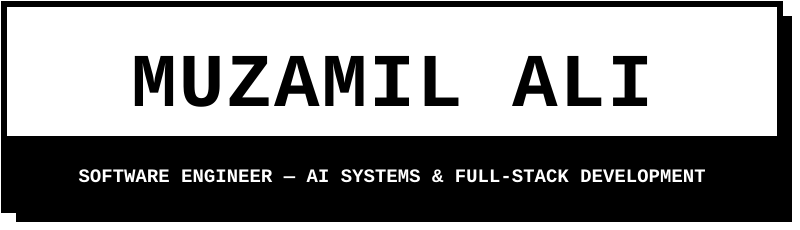

  

 

 

I’m a **Software Engineering Intern at Agento** and a third-year Computer Science student at **FAST-NUCES Karachi**. I build AI workflows, backend services, and full-stack applications, including an ERP used daily by a local water plant.

At Agento, I contribute to a workflow automation platform, working on:

- 🟨 **AGENT GUARDRAILS:** rules that limit what AI agents can do, with automatic stops and alerts.
- 🟪 **BACKEND RELIABILITY:** fixed OAuth state across multiple servers by moving it to Redis.
- 🟦 **PERFORMANCE AND MONITORING:** caching and monitoring (Azure Application Insights) for a multi-tenant platform.

I also teach C programming to beginners, focusing on problem-solving, pointers, and memory management.

 

 

 

 

> Built solo for a reverse osmosis (RO) water plant to manage customers, pricing, deliveries, and billing. **FastAPI, React/Vite, PostgreSQL.** Cut daily dispatch preparation from **20 minutes to under 5**. Used daily by the business.
>
> **→ [READ THE CASE STUDY](https://www.muzamilali.online/tulip-erp.html)**

 

> Queue screenshots in memory and send them all into an AI chat with one shortcut. Built in **Rust**; works in ChatGPT, Claude, and WhatsApp with no app-specific code. Cut a 9-screenshot task from **17 tab switches to 1**. About 15 MB of RAM when idle. Open source (MIT).
>
> **→ [DOWNLOAD THE LATEST RELEASE](https://github.com/M-uzamilAli/SnapRelay/releases/latest)**

 

> I built the backend and API integrations. Extracts summaries, tasks, and deadlines from documents with the **OpenAI API** and routes them to Google Sheets, Discord, or email through **n8n**.

 

> Always-on-top desktop widget that pulls tasks from **ClickUp, GitHub, and Google Classroom** into one window. **Electron, React, Node.js.**
>
> **→ [DOWNLOAD THE LATEST RELEASE](https://github.com/M-uzamilAli/Sticky-Todo-Desktop-App/releases/latest)**

 

> A browser game where your phone is the controller: tilt the phone to move the drone. Pairs by **QR code** over local Wi-Fi and predicts tilt about **40 ms ahead** to hide delay.

 

**[me@muzamilali.online](mailto:me@muzamilali.online)**

